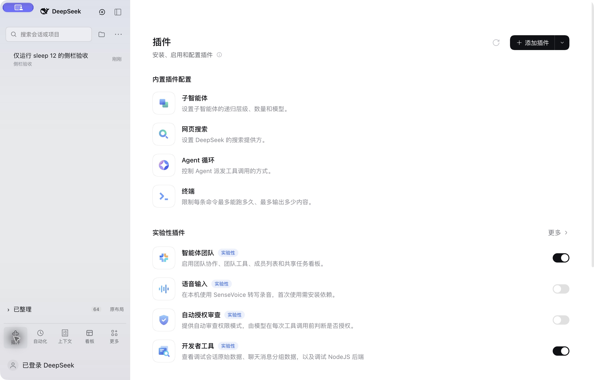
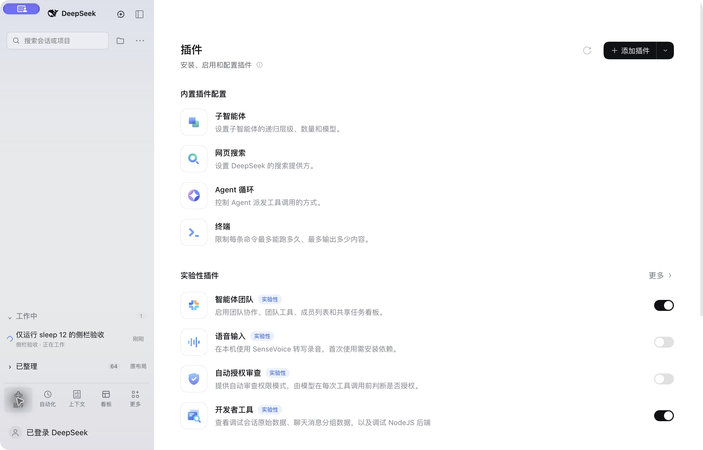
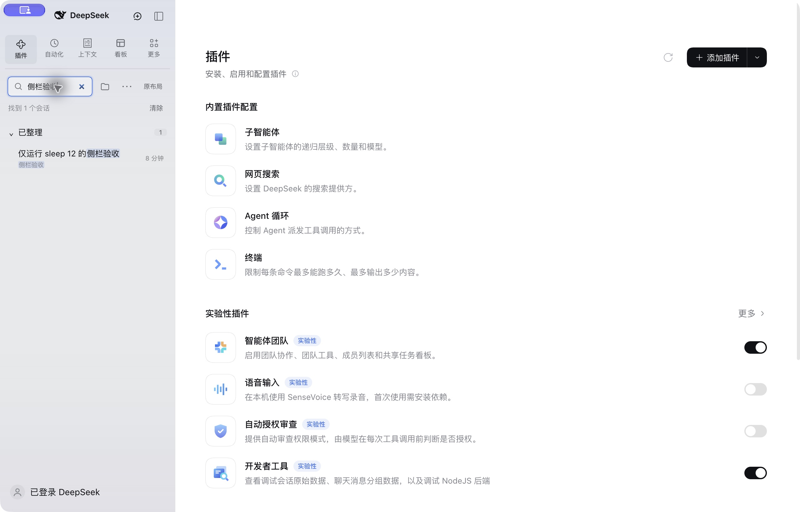
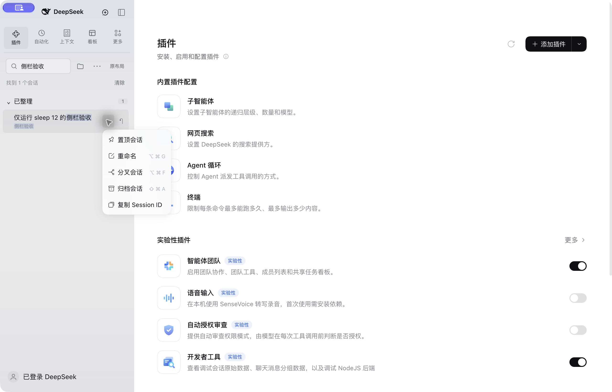
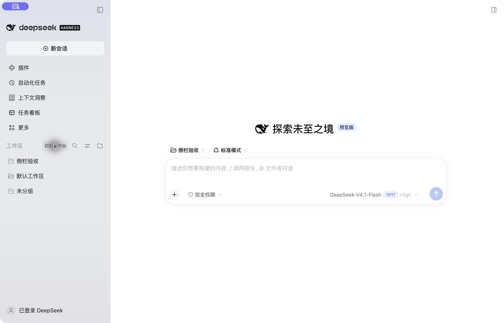
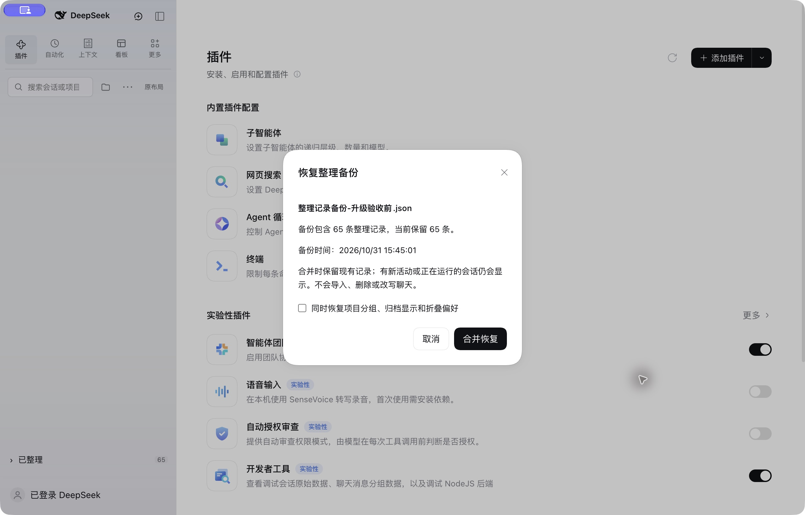

# DSH Session Workbench

[简体中文](README.zh-CN.md) · [MIT license](LICENSE)

A compact session sidebar for **DeepSeek Harness 0.2.2-rc.1**. Group conversations
by project when needed, review completed or actionable chats in an **untitled
upper inbox**, keep unattended runs in a bottom **Working** shelf, and manually
move finished work into **Settled**. Restore the original DSH layout with one click.

The current workbench labels are Chinese. Version `0.4.3` updates the native
workspace adapter and context-menu integration for DSH `0.2.2-rc.1`. Automated
checks use the official runtime in an isolated Windows Web profile: installation,
startup, native menus (button, right click and Shift+F10), search, Settle/restore,
and layout switching at 1280×820 and 1471×1200. The menu/list checks use an empty
test session presented as nonblank by a browser-only fixture; no model API runs.
Desktop, macOS, Linux, mobile, live model turns and arbitrary third-party plugin
combinations on this new DSH version remain unverified.

For DSH `0.2.1-rc.5`, keep plugin `0.4.2`. Its original macOS Desktop checks and
the Windows fix inherited from `0.4.1+windows.1` covered Windows Desktop cold-start,
compact-grid, and original-layout checks at 1280×820 and 1471×1200, plus search,
project filtering and native session-menu checks on DSH `0.2.1-rc.5`.
Those earlier checks do not establish Desktop compatibility with DSH `0.2.2-rc.1`.



Completed work stays at the top without a section heading. During execution,
Working appears above Settled at the bottom:



## Install

In DSH Desktop, open **Plugins → Add plugin → Git source** and use:

```text
https://github.com/Tracest/dsh-session-inbox
```

For a command-line web profile:

```sh
dsh plugin --profile web add git+https://github.com/Tracest/dsh-session-inbox.git
```

Use the profile that serves your application. Installing into `web` does not
change DSH Desktop's `desktop` profile. The compiled browser bundle is checked
in, so installation does not run a build script or require an npm account.
After installation, exit and reopen DSH when its tasks are idle so all UI
dependencies bind to the replacement workspace module.

This package declares an exact `engines.dsh` requirement intentionally. It
adapts a version-specific UI contract and must be revalidated before widening it.

If you are upgrading the earlier local-only build, remove its marked
`# dsh-session-inbox managed section` override using that build's recovery script
before adding this standard bundle. Never load both copies at once. Chat logs
and local Settle records use the same storage key and remain available.

## Discover index

On DSH 0.2.2, enable the experimental **Custom plugin indexes** bundle, then
add this URL in **Plugins → Discover → Add index source**:

```text
https://raw.githubusercontent.com/Tracest/dsh-session-inbox/main/market/index.json
```

This is the author-maintained source for this plugin. It is separate from
community catalogs, whose inclusion is subject to their own review.

## What it changes

- Compact header with New session and the native sidebar toggle.
- One search row with project filter and list options.
- The upper inbox has no section title. Completed, idle and awaiting-input chats
  are shown there directly; they remain until manually settled.
- Only unattended running work goes into the bottom Working shelf. Completion
  or a request for input returns it to the upper inbox, ordered by return time.
  The Working shelf is hidden when empty.
- Project grouping is optional and defaults off. It groups only the upper inbox;
  bottom shelves stay compact and show the project on each row.
- Settle and Restore change only the plugin's list metadata. They do not
  archive, delete, stop, or rewrite a conversation.
- Settled stays at the bottom and scrolls independently when expanded.
- The native global tool entries sit in a compact top grid, retaining their icons,
  accessible names, callbacks and registration order. The account menu stays below.
- The **原布局** button restores the complete original sidebar and session
  browser from the top control row. **切到工作台** returns to the workbench.
  Original mode keeps the native list's default spacing and CSS; a small return
  control sits beside its header and hides while native search is expanded.
- Search temporarily reveals matching shelves and project groups, highlights
  literal matches, and restores saved folds when cleared. It searches titles,
  project names and paths, not conversation bodies.
- The row's **⋯**, right click or Shift+F10 opens the native session menu, including
  pin, rename, fork, archive and registered menu extensions. Double-click a title
  to rename it.
- Unseen completions have a dot and bold title; opening or settling acknowledges
  them. Pending approval, questions and plan reviews sort first in the untitled inbox.
- The native search shortcut still works (Command+K by default on macOS). Arrow
  keys select rows, Home/End move to the first/last visible row, Enter opens,
  Shift+Enter settles/restores, and Escape clears search and focuses its input.
  These list keys do not handle events from the conversation editor.

The folder button filters projects. **⋯** controls project grouping, native
archive visibility, project management, and refresh. An archived chat's open
button is explicitly labelled “restore and open”: that action uses DSH's native
unarchive operation; Settle does not.

Search reveals settled matches without changing saved folds:



Native session operations are available directly in the workbench:



Original mode restores the native sidebar and list styling, with a small return
control beside the list header:



## Compatibility with other plugins

This is a session-browser replacement, not a universal skin for every plugin.

| Plugin extension | Behavior |
| --- | --- |
| Standard `sidebar.panellist` entries | Discovered by the official sidebar and displayed in the top tool grid; additional entries wrap onto another row. |
| Models, tools, MCP, skills, conversation panels | Their registrations and configuration remain in DSH. This package does not replace them. |
| Context, image generation, tide badge, task board | Coexistence and their available UI entries were verified on macOS DSH 0.2.1-rc.5. |
| Native session-row menus, leading decorations and hover extensions | Rendered through the original slot contracts, retaining native operations and permission checks. Individual third-party extensions still need their own verification. |
| Extra hover buttons registered only through `sidebar.workspaces.session.row.action` | The workbench keeps its menu and Settle actions compact. Row-button-only extensions remain available in the original layout. |
| Another plugin replacing `sidebar`, `sidebar.workspaces`, or the `uiWorkspace` service | Mutually exclusive unless specifically adapted. Keep only one replacement enabled. |
| Themes that override sidebar geometry or generated native classes | May need an adaptation; not covered by a blanket compatibility claim. |

## Data and removal

Preferences, collapsed groups, and Settle marks stay in the current DSH
browser origin's `localStorage`, under `dsh-session-inbox:state:v1`. They are not
part of the chat log and are not shared across devices. Clearing site data
removes those extra marks. Fresh user activity or renewed execution reopens a settled conversation; it
returns to the upper inbox once execution completes. Old history hydration
does not reopen a settled conversation.

Use **⋯ → 导出整理备份…** to save a JSON backup and **恢复整理备份…** to preview
and merge it. The file contains session identifiers, Settle timestamps and display
preferences; it excludes conversation bodies, titles, paths and account settings.
Keep it with your own files. Import retains current marks and preferences by
default, with an optional preference restore. Active, waiting and newly updated
conversations cannot be hidden by importing an old backup. This is list metadata
backup, not a conversation export or cross-device chat sync. A saved file is
needed to recover those marks after clearing site data.



Switching layouts does not uninstall anything. To remove a standard bundle, use
DSH's plugin manager, or for the CLI profile:

```sh
dsh plugin --profile web remove dsh-session-inbox
```

Then restart when idle. DSH restores its official workspace module. The optional
`install.py` and `.command` files are only for local macOS installation; their
recovery helper removes only its own profile override, not a manager-installed
bundle. No install-time script runs automatically.

## Development

```sh
npm run build
npm test
npm pack --dry-run
```

No JavaScript dependencies are needed to build the checked-in browser adapter.
`build.mjs` verifies its replacement hooks, normalizes Windows checkout line endings,
syntax-checks the output, and records upstream hashes. At startup, compact styles
resolve the current class map from the official sidebar's own loaded stylesheet.
The official `ui-sidebar` remains loaded. Neither `app.asar` nor user conversations are patched.

Checks cover classification, safe Settle/restore, resumed work, corrupt state,
partial catalogs, legacy preferences, stale timestamp hydration, and previously
settled empty chats. The macOS desktop was also exercised with real model
turns, project creation/rename, filters, collapse/expand, native tool navigation,
layout switching, and cold starts. That evidence does not establish universal
third-party or cross-platform support.
Search expansion, literal highlighting, pending priority, completion acknowledgement,
backup validation and merge preservation have additional regression checks.
The native fallback's three CSS payloads and stylesheet lifecycle are also checked,
including switching modes and disposing a replaced UI module.
The adapter uses the native context-menu service for the row menu, right click
and Shift+F10, and checks native access before enabling title double-click rename.

## Attribution

[DeepSeek's MIT notice](vendor/LICENSE.deepseek) is retained for the version-pinned
native workspace adapter. See [THIRD_PARTY_NOTICES.md](THIRD_PARTY_NOTICES.md).
The compact header and Working/Settled organization were inspired by T3 Code.
This workbench keeps its tool grid above the list; no T3 Code implementation is included.

Independent community project, not affiliated with DeepSeek or T3 Code.
