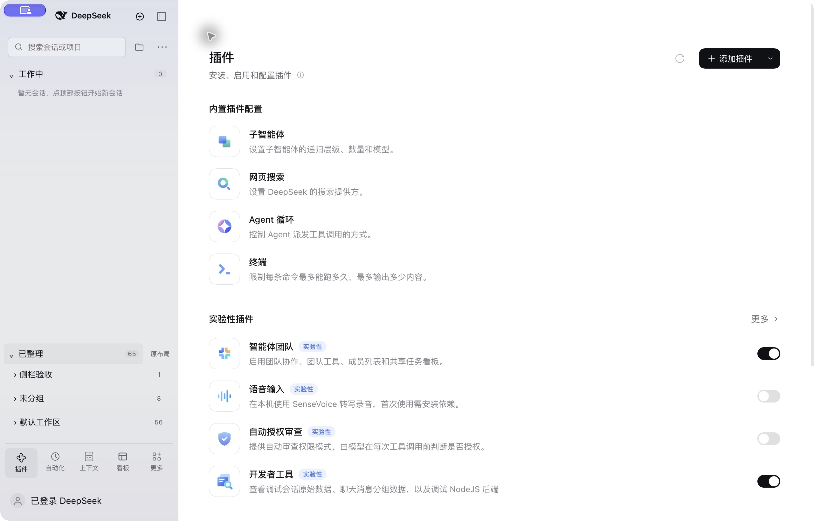

# DSH 会话工作台

[English](README.md) · [MIT 许可证](LICENSE)

包名：**`dsh-session-inbox`**。适配 **DeepSeek Harness 0.2.1-rc.5**，界面为中文，
已在 macOS 官方桌面版实际验证。支持项目分组、工作中 / 已整理两栏、一键 Settle 和完整原布局切换。



## 安装

在 DSH 桌面版中打开“插件 → 添加插件 → Git 来源”，填写：

```text
https://github.com/Tracest/dsh-session-inbox
```

命令行启动的 Web 版可运行：

```sh
dsh plugin --profile web add git+https://github.com/Tracest/dsh-session-inbox.git
```

`web` 和桌面版的 `desktop` 是不同配置。请安装到实际运行的配置中。包内已有编译结果，
安装时不运行构建脚本，也不需要 npm 账号。安装完成后在任务空闲时正常退出并重新打开 DSH，
使界面依赖完整重新绑定。

兼容版本刻意限定为 `0.2.1-rc.5`，因为原生界面接口和类名与版本绑定。
Web 界面可加载同一组件；Windows、Linux 桌面布局尚未验收，当前不承诺支持。

从早期本地版升级：先用早期版本的恢复脚本移除 `# dsh-session-inbox managed section` 覆盖段，
再安装标准插件包，避免两份同时加载。聊天不删除，整理状态沿用同一个本地存储键。

## 发现页订阅

在 DSH 0.2.1 中开启实验性“自定义插件市场”，然后进入“插件 → 发现 → 添加索引源”，填写：

```text
https://raw.githubusercontent.com/Tracest/dsh-session-inbox/main/market/index.json
```

这是作者维护的可直接安装索引，与需要单独审核的社区总目录是两回事。

## 使用

- 顶部是紧凑标识、新会话和收起按钮；搜索、项目筛选、列表设置共用一行。
- 与 T3 一样，未整理会话统一留在“工作中”，包括运行中、等待回复和空闲会话；正在运行或等待审批时在会话行内显示状态，不再设置“需要处理”分栏。
- 会话右侧 ✓ 执行 Settle，移入底部已整理；↶ 可恢复。运行中或等待回复时不能误整理。
- Settle 只改列表元数据，不执行归档、删除、停止或聊天日志改写。会话再次运行或有新消息会自动重新出现。
- 已整理固定在底部，展开内容独立滚动。
- 官方全局面板入口移到底部，保留图标、文字、注册顺序、点击行为和账号菜单。
- 点已整理右侧的“原布局”恢复完整原生侧栏与列表；点“切到工作台”返回。
- 文件夹按钮筛选项目；“⋯”设置分组、原归档显示、管理项目和刷新。
- 带“原生归档”标识的聊天，其打开按钮明确为“恢复并打开”，该操作会使用 DSH 的原生恢复功能；Settle 不改变归档状态。

## 与其他插件的兼容范围

这是会话浏览器替换插件，不是所有插件都通用的皮肤。

| 插件类型 | 当前行为 |
| --- | --- |
| 使用标准 `sidebar.panellist` 注册的入口 | 官方侧栏自动发现并显示在底部；数量增加时自动换行。 |
| 模型、工具、MCP、技能、聊天内面板 | 保留原配置和注册，不由本插件接管。 |
| 上下文、图片生成、计费提示、任务看板 | 已在 macOS DSH 0.2.1-rc.5 中验证共存及其已有界面入口。 |
| 原生会话行菜单、悬浮信息或行操作扩展 | 原列表中保留；工作台使用自己的会话行，需要这些扩展时切到原布局。 |
| 同样替换 `sidebar`、`sidebar.workspaces` 或 `uiWorkspace` 服务的插件 | 默认互斥，需要专门适配；同时只启用一个替换实现。 |
| 修改侧栏几何结构或原生生成类名的主题 | 可能需要适配，不作全部兼容保证。 |

## 数据与卸载

整理、折叠和显示偏好保存于当前 DSH 来源的 `localStorage`，键为 `dsh-session-inbox:state:v1`。
它们不会改写历史，也不会跨设备同步；清理站点数据会重置这些额外标记。
旧摘要补齐或重连不会取消已有 Settle 标记。此前已整理过的空会话也保留在已整理中。

日常用“原布局”切换即可。卸载标准包请使用 DSH 插件管理，命令行 Web 配置也可运行：

```sh
dsh plugin --profile web remove dsh-session-inbox
```

任务空闲时重启后恢复官方模块，聊天和整理元数据保留。

`install.py` 和 `.command` 是可选的 macOS 本地安装辅助，不会在标准安装时自动执行。
本地恢复脚本只移除它自己的覆盖段，不能替代标准插件包的卸载。

## 开发与验证

```sh
npm run build
npm test
npm pack --dry-run
```

构建不需要额外 JavaScript 依赖。构建脚本检查替换点、解析固定版本类名、检查输出语法并记录上游哈希。
官方侧栏模块继续加载；不修改 DSH 的 app.asar 或用户聊天日志。

逻辑检查覆盖分类、整理与恢复、重新运行、损坏存储、部分目录、旧版偏好、旧摘要时间戳及已整理空会话。
桌面实测覆盖真实模型轮次、项目创建和重命名、筛选、收起展开、功能入口、原布局往返和冷启动。
这些证据不等于所有第三方插件或所有平台均已验证。

## 许可证与来源

MIT。固定版本的 DSH 原生会话适配代码保留 [DeepSeek 的 MIT 许可证](vendor/LICENSE.deepseek)。
详见 [第三方声明](THIRD_PARTY_NOTICES.md)。布局参考 T3 Code 的紧凑顶部、底部工具栏和 Working/Settled 结构，
没有包含 T3 Code 的实现代码。这是独立社区项目，不是 DeepSeek 官方产品。
